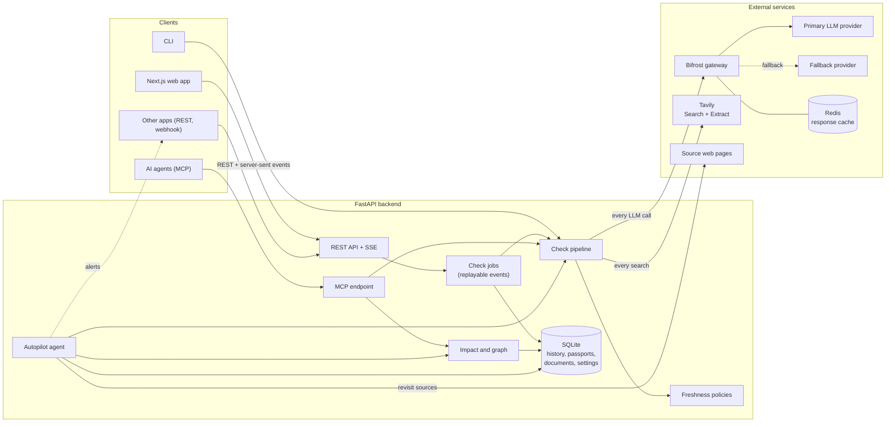
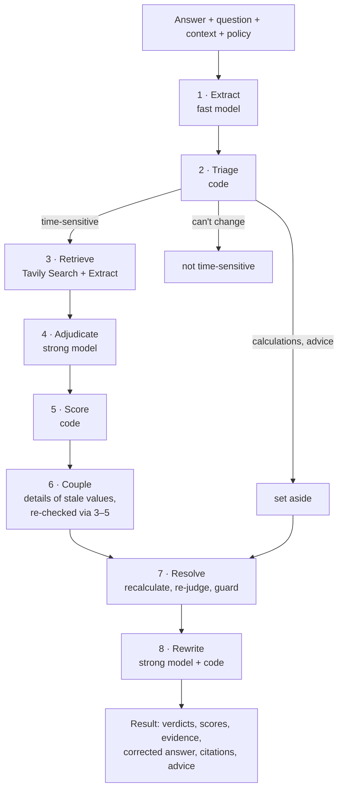
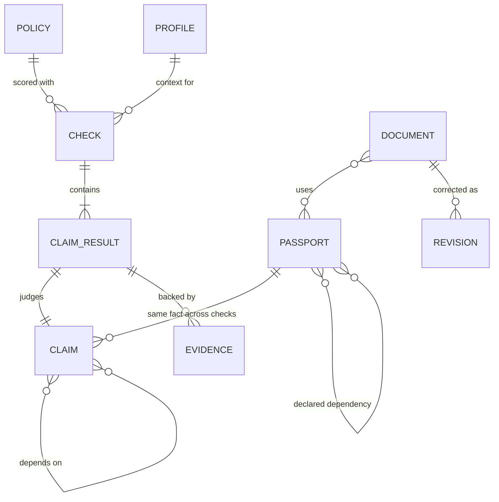
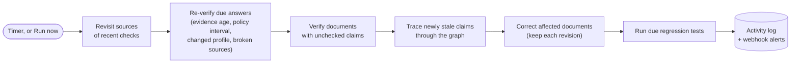

<p align="center">
  
</p>

<h1 align="center">ShelfLife</h1>

<p align="center"><strong>Find the claims in an AI answer that have gone out of date, fix them consistently, follow them downstream, and keep everything fresh on its own.</strong></p>

<p align="center">Built for the Geek Room Global AI Hackathon 2026 · Problem statement 06 (Tavily)</p>

---

## Contents

1. [Overview](#overview)
2. [The problem](#the-problem)
3. [The solution](#the-solution)
4. [See it working](#see-it-working)
5. [Features](#features)
6. [Technical architecture](#technical-architecture)
7. [Implementation](#implementation)
8. [Technologies used](#technologies-used)
9. [How Tavily contributes](#how-tavily-contributes)
10. [How Bifrost contributes](#how-bifrost-contributes)
11. [Installation](#installation)
12. [Configuration](#configuration)
13. [Using ShelfLife](#using-shelflife)
14. [Testing and evaluation](#testing-and-evaluation)
15. [Project structure](#project-structure)
16. [Safeguards](#safeguards)
17. [Known limits](#known-limits)
18. [Future scope](#future-scope)

---

## Overview

Language models answer from training data with a cutoff. They state old prices, versions, office holders, laws and statistics with full confidence, and nothing in the answer says which parts have expired.

**ShelfLife** is a freshness layer for AI answers. Give it an answer, and it:

- **finds** every claim that can change over time, including hidden assumptions, calculations and advice built on other claims;
- **checks** each one against live web sources through **Tavily**, judging every source's stance with a quote that code verifies is really on the page;
- **scores** each claim from 0 to 100 in code, from the authority, age and agreement of its sources, so every number can be explained;
- **reads each claim in context**: on its own timeline (a claim about June 2025 is judged as of June 2025) and in its passage (a release date written beside "the latest version" is re-checked when the version changes);
- **repairs** the answer, changing only what is stale, keeping related values consistent, and citing a source for every change;
- **advises** the app showing the answer: show it, show it with a warning, or hold it back.

Beyond a single answer, ShelfLife traces a stale fact to every **document and answer built on it**, keeps a **dependency graph** of claims across answers, applies per-app **freshness policies**, and can run **fully autonomously**: re-verifying, correcting and alerting without being asked. It plugs into other agents as an **MCP server**.

Every LLM call goes through the **Bifrost** gateway, which provides model tiering, automatic fallbacks, response caching and a budget.

## The problem

| Problem | Why it matters |
|---|---|
| **Models answer from a frozen snapshot.** | "The latest version is 3.13" or "the Starter plan costs $20" may have been true at training time and wrong today, with no signal to the reader. |
| **Fact-checkers ask the wrong question.** | They ask *is this true?* An AI answer needs *is this still true, what changed, and when should we look again?* |
| **Facts don't stand alone.** | Answers calculate with facts ("10 seats cost $200"), assume things ("the plan allows 10 seats") and recommend ("Nimbus is cheapest"). A stale price silently breaks the total and the advice. |
| **Context changes the meaning.** | "Launched on October 7, 2024" is true of version 3.13, but wrong once the sentence says 3.15. "In 2019 the latest Python was 3.8" is correct forever, even though 3.8 is long gone. A claim must be judged on its own timeline and in its own passage. |
| **One stale fact spreads.** | The same price ends up in a proposal, a budget projection and a customer email. Finding it in one answer isn't enough; everything built on it needs updating. |
| **Different apps need different freshness.** | A history tutor and a production deployment assistant should not re-check API versions on the same schedule. |
| **Freshness decays continuously.** | A check is only valid for a while. Someone has to re-check, revisit sources and update outputs, every day. |

## The solution

| Problem | How ShelfLife solves it |
|---|---|
| Frozen snapshot | Every time-sensitive claim is searched with Tavily and judged only from live sources. The pipeline never uses a model's memory for current values. |
| The wrong question | Each claim gets a freshness score, a verdict (fresh, uncertain, stale, unverified), what changed (old value → new value, kind of change), and a re-check date. |
| Facts don't stand alone | Calculations are stored as formulas and recomputed in code. Recommendations are re-judged when a fact under them changes. Hidden assumptions are checked like stated claims. |
| Context changes the meaning | Claims carry a time frame (current, past, future) read from the whole question and answer. Details tied to a changed value are re-checked for the new value and corrected together with it. The judge sees the question and the surrounding passage. |
| One stale fact spreads | Documents and answers are linked to claim passports. The impact analyzer walks the dependency graph and writes a corrected version of every affected document. |
| Different freshness needs | Freshness policies set half-lives, re-check intervals and hold-back rules per kind of fact, with presets for common kinds of app. |
| Continuous decay | Autopilot mode re-verifies due claims, revisits sources, corrects documents and runs regression tests on its own, with a spending budget per cycle and a full activity log. |

## See it working

- **Without any keys:** set `DEMO_MODE=true` (see [Installation](#installation)). Every page runs on a built-in simulator of Bifrost, Tavily and the web with invented companies and prices, and the web app starts an **automatic guided walkthrough** that drives every feature and explains each one beside it on screen. Replay it from the button in the bottom corner.
- **Demo video:** a timed transcript and subtitles are in [docs/demo-video/](docs/demo-video/).
- **Feature-by-feature guide:** [docs/testing.md](docs/testing.md). **Three-minute run-sheet:** [docs/demo.md](docs/demo.md).

## Features

### Verify

- **Claim extraction.** A fast model splits the answer into self-contained claims, each with a category, a kind, search queries, its position in the text and what it depends on. Code re-locates every claim in the answer rather than trusting the model's offsets.
- **Kinds of claim.** Facts, hidden assumptions (up to three things the answer takes for granted), calculations with formulas, recommendations, code and API usage, and availability.
- **Live verification.** Each time-sensitive claim is searched with Tavily; a strong model records whether each source supports or contradicts it, backed by a quote that code checks is really in the source.
- **Freshness score and verdict.** Calculated in code from authority, recency and agreement, with an evidence-strength figure and a full breakdown for every claim. See [The freshness score](#the-freshness-score).
- **What changed.** The old value next to the new one, and the kind of change: new value, superseded, deprecated, discontinued or renamed.
- **Independent sources.** Pages from the same owner or repeating the same story count once.
- **Context.** Check an answer for a reader's country, plan or edition, software environment and currency. Local claims are searched for that country and judged for that reader; a claim true in general but not for them is flagged. Saved context profiles flag older checks when the profile changes.
- **Timelines.** Each claim is judged as of the time it describes. A past claim is shown as *correct* or *wrong for its time* and never needs re-checking; a planned one is checked against what happened.
- **Re-check dates.** The day each fresh or uncertain claim's evidence will be too old to keep its verdict, or sooner under the freshness policy.
- **Answer guard.** Advice for the app: show, show with a warning, or hold back.

### Correct

- **Corrected answer.** Only stale passages change; everything else stays word for word. Each change cites its source, and the web app shows the changes as a diff.
- **Consistent corrections.** Overlapping claims (a version and the release date beside it) are corrected in one edit, each value with its own source.
- **Recalculated figures and re-judged advice.** Totals are recomputed with current values; recommendations are re-judged using only the checked facts.
- **Reports.** Every check downloads as Markdown or JSON.

### Keep fresh

- **Downstream impact.** Register the documents built from answers (proposals, projections, emails, reports). When a claim goes stale, ShelfLife lists every dependent claim, answer and document, and writes a corrected version of each document with recalculated figures and sources. Every revision is kept.
- **Dependency freshness graph.** Claims, what they rely on, and the documents built on them, across all answers. Apps can declare cross-answer dependencies, such as an SDK version that relies on a runtime version. Selecting a claim lights up its blast radius.
- **Freshness policies.** Presets for balanced use, developer assistants, production APIs, business intelligence and research, plus your own; pick a default or pass one per check.
- **Autopilot (manual or auto mode).** In auto mode ShelfLife re-verifies due claims, revisits sources, verifies new documents, traces each newly stale claim downstream, corrects the documents built on it and runs regression tests, all on its own.
- **Verification passports.** Each claim gets a stable `CLM-…` ID and a record of every check, its sources and its verdict history.
- **Check history and watchlist.** Verdicts over time for each answer, and claims due for a re-check.
- **Regression tests.** Re-ask a model a saved question through Bifrost and fail when its answer goes stale or misses required words.
- **Link rot.** Revisit every source a check relied on and flag pages that moved, were deleted, or no longer contain the quoted evidence.
- **Compare AI apps.** Answers from 2–5 assistants to the same question, every version judged against the same sources.
- **Batch checks.** Up to 20 answers from pasted text or a CSV file.

### Integrate

- **MCP server** for AI agents (Claude, IDE agents, agent frameworks), over HTTP or stdio.
- **One-call answer guard:** `POST /api/verify`.
- **Webhook alerts** for stale findings and their downstream impact.
- **Bookmarklet** to send an answer from any website, a **CLI**, and a full **REST API** with live progress events.

### The web app

| Page | What it's for |
|---|---|
| **Check an answer** | Check one answer, with optional context and freshness policy. Tabs show the checked answer, the corrected answer, how claims depend on each other, and whether sources still exist. |
| **Compare apps** | Line up 2–5 assistants' answers to the same question. |
| **Claims** | Every claim ever checked, with its verification passport. |
| **Impact** | Stale claims ranked by blast radius; registered documents with corrected versions and revisions. |
| **Dependency graph** | The freshness graph, load-bearing claims, blast radius, declared dependencies. |
| **Autopilot** | Manual or auto mode, cycle settings, pending work and the live activity log. |
| **Policies** | Preset and custom freshness policies; the default policy. |
| **Monitors** | Regression tests, link checker, batch checks and context profiles. |
| **Dashboard** | Totals, checks per day, verdicts by kind of fact, held-back answers, due re-checks, context changes, Bifrost and Tavily usage. |
| **Evaluation** | Precision, recall and false alarms on the human-labelled dataset. |
| **System** | Bifrost, virtual key, budget, cache plugin and Tavily status; integrations; bookmarklet; API reference. |

The interface has a grouped sidebar, a Manual/Auto switch on every page, light and dark themes, and works on phones.

## Technical architecture

### System overview



| Component | Responsibility | Code |
|---|---|---|
| **Web app** | Every page, live claim highlighting, diff view, graph, guided walkthrough. | `frontend/` |
| **REST API** | Starts checks, streams progress as server-sent events, serves the workspace pages. | `app/main.py`, `app/routes.py`, `app/routes_freshness.py` |
| **Check jobs** | Runs checks in the background; stores every event so a client can reconnect and replay. | `app/jobs.py` |
| **Pipeline** | The eight stages below. | `app/pipeline/` |
| **Freshness policies** | Half-lives, re-check intervals and guard rules per kind of fact. | `app/policies.py` |
| **Impact and graph** | Documents, claim links, declared dependencies, impact reports, the graph. | `app/impact.py` |
| **Autopilot** | The autonomous agent loop and its activity log. | `app/agent.py` |
| **MCP server** | Tools for AI agents over HTTP and stdio. | `app/mcp.py`, `app/mcp_stdio.py` |
| **LLM client** | Bifrost calls, schema validation, retries, routing and cost metrics. | `app/llm.py`, `app/pipeline/metrics.py` |
| **Search client** | Tavily Search and Extract, retries, a short-lived disk cache. | `app/search.py` |
| **Storage** | Checks, passports, profiles, tests, comparisons, policies, documents, edges, settings and agent events in SQLite. | `app/history.py`, `app/workspace.py` |
| **Simulator** | A stand-in for Bifrost, Tavily and the web with invented data, for keyless demos and tests. | `app/demo/` |

### The check pipeline



| # | Stage | Done by | What happens |
|---|---|---|---|
| 1 | **Extract** | Fast model | Splits the answer into claims with category, kind, time frame, search queries, position, dependencies and formulas, plus hidden assumptions. Code re-locates each claim in the text. |
| 2 | **Triage** | Code | Skips claims that can't go out of date, sets aside calculations and recommendations, and caps the number checked, claims about now and the fastest-changing first. |
| 3 | **Retrieve** | Tavily | Searches each claim, several at a time, with the reader's country where it matters; reads thin official pages in full with Tavily Extract; drops duplicate URLs. |
| 4 | **Adjudicate** | Strong model | Records each source's stance with a verified quote, the current value, the stated value and the kind of change, reading the claim in its passage and on its timeline. |
| 5 | **Score** | Code | Authority × recency × agreement under the freshness policy's half-life; independence grouping; verdict and re-check date. |
| 6 | **Couple** | Fast model + stages 3–5 | Finds details written about a now-stale value, restates them about the current value, and checks them. |
| 7 | **Resolve** | Code + strong model | Recomputes calculations with current values, re-judges recommendations whose facts changed, and decides the guard advice. |
| 8 | **Rewrite** | Strong model + code | Writes a drop-in replacement for each stale passage (overlapping claims together); code validates it and splices it in by character offset, adding citations and flags. |

The web app receives an event after each stage and after each claim (`claims_extracted`, `claim_evidence`, `claim_scored`, `metrics`, `rewrite_ready`, `done`), so the answer fills in live. Events are stored with the job, so a browser that disconnects can resume with `Last-Event-ID`, and the check keeps running either way.

### Data model



- A **claim** has text, a span in the answer, a category, a kind, a time frame (`current`, `past`, `future` and the date it describes), dependencies and an optional formula.
- A **claim result** adds the verdict, score, evidence, current value, what changed, re-check date, recalculation, recommendation decision and, for coupled details, what the claim was checked as.
- A **passport** (`CLM-` plus a hash of the normalised text) ties the same fact together across checks.
- **Documents** store their own extracted claims; links to passports are worked out when needed, by ID when the app declared them and by meaning otherwise.

### Autopilot cycle



Each cycle starts at most a set number of checks (3 by default) to bound spend. In manual mode the loop is idle, and **Run a cycle now** runs one on request.

## Implementation

### Claims, located and typed

The extraction prompt asks for the shortest passage that states each claim; code then finds that passage in the answer (exact, case- and spacing-insensitive, then best-matching sentence), so highlights and corrections land on the right words even when a model miscounts characters. Claims carry `depends_on` links, and calculations a formula such as `{c2} * 10`, which code evaluates with a safe arithmetic parser.

### Timelines

The extractor decides each claim's time frame from the question and the whole answer, not the sentence's tense: "Jack Dorsey is the CEO" answering "Who was CEO in 2020?" is a past claim about 2020. Past claims keep their time in the text ("In June 2025, …"), are searched with general rather than news results, and are scored with sources aged against that date: a page written later can report it, a page from well before it loses weight. They never get a re-check date, and a wrong one is corrected with the value at that time. A "past" date that is still in the future is rejected and the claim judged as current.

### Coupled details

When a claim turns stale, any claim that shares its passage or refers back to it ("version 3.13, *launched on October 7, 2024*") is restated about the current value ("3.15 was launched on October 7, 2024") and checked from scratch. If the restatement can't be confirmed, the rewrite must remove the detail instead of leaving it describing the wrong thing. A detail about a past time is never moved to today's value.

### The freshness score

For each source that supports or contradicts a claim:

- **Authority** `a`: 1.0 for the entity's own site or a government site, 0.8 for major news agencies, 0.7 for tech and trade press, 0.6 for Wikipedia, 0.4 for unknown sites and 0.2 for forums and social media.
- **Recency** `r = 0.5 ^ (age in days / half-life)`. A source with no date gets 0.7 if it's official and 0.35 otherwise.
- **Weight** `w = a × r`.

With `S` the total weight of supporting sources and `C` of contradicting ones:

```
if S + C < 0.15:  no score, verdict "unverified"
score = round(100 × S / (S + C) × (0.5 + 0.5 × recency of the newest supporting source))
```

Sources that share an owner or repeat the same story count once per stance: only the heaviest adds weight. **70+ is fresh, 40–69 uncertain, below 40 stale.** A recent official contradiction makes a claim stale even if old blogs still agree, and a claim supported only by old sources lands in uncertain.

| Category | Default half-life |
|---|---|
| Current events | 30 days |
| Pricing | 90 days |
| Versions and APIs, product status | 120 days |
| Statistics | 180 days |
| Leadership | 365 days |
| Laws and regulations | 540 days |

A score of 0 is a confident "out of date", not a failure: the claim card shows a separate **evidence strength**, `1 − e^(−(S + C) / 0.8)`. The **re-check date** is the first day the verdict would change if no new evidence appeared, found by re-running the formula on future dates. Constants live in `backend/app/config.py`; `scripts/eval_tune.py` tests other values against the labelled dataset.

### Corrections

The model writes only a short replacement per stale passage. Code rejects any replacement that adds a number not in the original or the current values, omits a current value, adds citation markers or runs long, and falls back to a plain "(now …)" note. Accepted replacements are spliced in by character offset, so the rest of the answer is untouched, and citation markers are added in code.

### Freshness policies

| Preset | For | What it changes |
|---|---|---|
| **Balanced** | General assistants | Default half-lives; hold back when half the claims are stale. |
| **Developer assistant** | Coding help | Versions and APIs age fast and are re-checked weekly; a stale API claim holds the answer back. |
| **Production API** | Deployed integrations | Versions and product status re-checked daily; stale ones hold the answer back at 25%. |
| **Business intelligence** | Leadership and figures | Leadership re-checked daily, figures weekly; stale prices, figures or leaders hold the answer back. |
| **Research assistant** | Historical and settled facts | Slow ageing; recent statistics re-checked monthly; hold back at 75%. |

Custom policies are validated (known categories, 1–3,650 days) and stored with the workspace. Presets can't be changed or deleted.

### Impact analysis

`impact.build_index` reads saved checks into the latest result per passport, edges from `depends_on` (labelled *describes* for coupled details) and declared edges, and the answers that state each fact. A document's claims match a passport by ID or by text similarity, but never when the document states the stale claim's *new* value or names a different API call, so a corrected document isn't "corrected" again. `impact_report` walks downstream breadth-first and records the path to each dependent claim, document and answer. Document analysis is cached until a linked verdict changes.

### Autopilot

An asyncio task started with the API. Mode, interval and per-cycle budget are stored settings; switching mode wakes the loop at once. Each action writes an event (cycle, links, recheck, document, impact, test) with a level and a reference that the web app links to. Repeated identical corrections are skipped, so cycles settle instead of looping.

### MCP server

A JSON-RPC handler implementing `initialize`, `ping`, `tools/list` and `tools/call`, served at `POST /mcp` (streamable HTTP, JSON responses) and over stdio. Tools: `verify_answer`, `impact_of_claim`, `stale_claims`, `register_document`, `link_claims`, `get_claim`, `watchlist`, `autopilot`, `list_policies`. Tool errors are returned as results with `isError: true`, so agents can read and act on them.

## Technologies used

| Layer | Technology | Role |
|---|---|---|
| Web search | **Tavily** Search and Extract APIs | The source of every current fact; see [below](#how-tavily-contributes). |
| LLM gateway | **Bifrost** (Maxim), OpenAI-compatible API | Every model call; tiering, fallbacks, cache, budget, logs; see [below](#how-bifrost-contributes). |
| Cache store | **Redis Stack** | Vector store for Bifrost's response cache. |
| Backend | **Python 3.11+**, **FastAPI**, **Uvicorn** | REST API, server-sent events, background jobs, the Autopilot loop. |
| Validation | **Pydantic 2**, **pydantic-settings** | Every model reply is validated against a schema; settings from `.env`. |
| HTTP | **httpx** (async) | Bifrost, Tavily and link-check calls, with a swappable transport for the simulator and tests. |
| Storage | **SQLite** | Check history, passports, workspace data, documents, settings and the activity log. |
| Agent protocol | **Model Context Protocol** (JSON-RPC) | Tools for AI agents, over HTTP and stdio. |
| Frontend | **Next.js 16**, **React 19**, **TypeScript** | The web app. |
| Styling | **Tailwind CSS 4**, **Base UI**, shadcn components, **lucide** icons | Interface, light and dark themes. |
| Typography | Geist, Geist Mono, Fraunces | Reading, numbers and display headings. |
| Tooling | **uv**, **npm**, **Docker Compose** | Python environment, frontend packages, Bifrost and Redis. |
| Testing | **pytest** + pytest-asyncio, **Vitest**, ESLint | 384 backend and 54 frontend tests, all against simulated services by default. |

## How Tavily contributes

Tavily is the source of every fact ShelfLife treats as current. The pipeline never uses a model's memory for current values.

| Tavily feature | How ShelfLife uses it |
|---|---|
| **Search topic** | Leadership, product status and current events use the `news` topic; pricing, versions, statistics and laws use `general`. Claims about a past time always use `general`. |
| **Published dates** (`include_published_date`) | Recency is half the score, so every search asks for dates. A source with no date gets a lower fixed recency. |
| **Country** (`country`) | For local claims (pricing, laws, product status, availability) with a chosen country, the query names it and Tavily boosts results from it. |
| **Preferred domains** (`include_domains` + `include_domains_mode: "prefer"`) | The entity's official domains rank first for pricing and version claims, while other pages still appear. |
| **Search depth** (`basic` / `advanced`) | The **Deep verify** switch moves to advanced search (two credits instead of one). |
| **Extract** | When the entity's own page returns a thin snippet, ShelfLife reads it with Tavily Extract, asking for the passages relevant to the claim (up to two pages per claim). |
| **Favicons** (`include_favicon`) | Source icons in the evidence list, with no third-party icon service. |
| **Usage endpoint** | The health check and dashboard read credits used instead of spending a search. |

Searches run several at a time under a concurrency limit, retry on rate limits, count their credits per check, and are cached on disk for at most six hours so the cache can never make answers stale.

## How Bifrost contributes

Every LLM call goes through Bifrost's OpenAI-compatible endpoint with ShelfLife's virtual key, and the web app shows what Bifrost did for each one.

| Bifrost feature | How ShelfLife uses it | Where you see it |
|---|---|---|
| **Model tiering** | `MODEL_FAST` extracts claims and restates coupled details. `MODEL_STRONG` judges evidence, re-judges recommendations and writes corrections. `MODEL_STALE` writes answers from memory; regression tests can ask any model Bifrost serves. | The metrics panel splits calls, tokens, cost and time by stage. |
| **Automatic fallbacks** | Every call sends a fallback list on another provider; Bifrost's routing information is recorded per call. | Each claim shows which model judged it and marks fallbacks. |
| **Response cache** (Redis) | Each stage has its own cache key (`x-bf-cache-key`), entries last at most 24 hours, and check stages match exactly. The judging prompt includes a hash of its evidence, so a cached verdict can never come from different evidence. Only the from-memory answer generator matches by meaning. | **Run again** compares cost, time and cache hits with the previous run. |
| **Virtual key and budget** | One virtual key (`x-bf-vk`) with a dollar budget; Bifrost blocks calls when it runs out and ShelfLife says so clearly. | The metrics panel and System page show spend against budget. |
| **Governance errors** | Missing, unknown or blocked keys and blocked models become messages that say what to fix. | Health check and error messages. |
| **Request logs** | Every call appears in Bifrost's logs. | The Bifrost dashboard. |
| **Admin API** | ShelfLife reads the cache plugin's state and can enable it. | The System page. |

The JSON schema for each stage goes in the prompt rather than a provider-specific `response_format`, so the same request works on every provider behind Bifrost, including fallbacks. Replies are validated with Pydantic and retried once, uncached, if invalid.

## Installation

### Prerequisites

- **Python 3.11+** with [uv](https://docs.astral.sh/uv/)
- **Node.js 20+** and npm
- For real checks: a **Tavily API key**, API keys for **two LLM providers**, and **Docker** (or another way to run Bifrost and Redis)

Run commands from the project root, the backend and web app in separate terminals. On Windows, use `copy` instead of `cp`.

### Option A: try it with no keys (simulated services)

```bash
cp .env.example .env
```

Set `DEMO_MODE=true` in `.env`, then:

```bash
cd backend && uv sync && uv run uvicorn app.main:app --port 8000
```

```bash
cd frontend && npm install && npm run dev
```

Open http://localhost:3000. The guided walkthrough starts on its own. All data is invented and nothing is spent.

### Option B: real services

1. **Configure.** `cp .env.example .env`, then set `TAVILY_API_KEY` and a long random `BIFROST_SETUP_TOKEN`.
2. **Start Bifrost and Redis.**

   ```bash
   docker compose up -d
   ```

   Bifrost listens on port 8080 and Redis on 6379. Without Docker, run `npx -y @maximhq/bifrost -app-dir ./bifrost` for Bifrost.
3. **Set up Bifrost** at http://localhost:8080: add keys for both providers; under **Virtual Keys**, create a key for ShelfLife that allows both providers and your models, with a budget (for example $5 a month), and put it in `BIFROST_VK`.
4. **Choose models** in `.env` as `provider/model` names: `MODEL_FAST`, `MODEL_STRONG`, `MODEL_STALE`, and `FALLBACKS_FAST` / `FALLBACKS_STRONG` with a model from the second provider.
5. **Start the backend and web app** as in option A (with `DEMO_MODE=false`).
6. **Check the setup.**

   ```bash
   cd backend && uv run python ../scripts/bifrost_setup.py --enable-cache
   ```

   It reports anything missing. http://localhost:8000/api/health checks Bifrost, the virtual key and Tavily.

### Turning on the response cache

Bifrost's cache needs a vector store. Add this to `config.json` in Bifrost's app folder (`bifrost/`), restart Bifrost, then run `bifrost_setup.py --enable-cache`:

```json
"vector_store": {"enabled": true, "type": "redis", "config": {"addr": "redis:6379"}}
```

Use `redis:6379` with Docker Compose and `localhost:6379` when Bifrost runs with `npx`. Redis needs the search commands (Redis Stack or Redis 8); everything else works without the cache.

### Other addresses

If the API isn't at `http://localhost:8000`, set `NEXT_PUBLIC_API_URL` in `frontend/.env.local`. If the web app runs on another address, add it to `CORS_ORIGINS` in `.env`.

## Configuration

All settings are read from `.env` (see `.env.example`).

| Setting | Default | Purpose |
|---|---|---|
| `TAVILY_API_KEY` | | Tavily key (required for real checks). |
| `BIFROST_URL` | `http://127.0.0.1:8080` | Bifrost address. |
| `BIFROST_VK` | | ShelfLife's Bifrost virtual key. |
| `MODEL_FAST`, `MODEL_STRONG`, `MODEL_STALE` | | `provider/model` names served by Bifrost. |
| `FALLBACKS_FAST`, `FALLBACKS_STRONG` | | Comma-separated fallback models, tried in order. |
| `MAX_CLAIMS` | `12` | Most claims searched per answer. |
| `TAVILY_CONCURRENCY`, `LLM_CONCURRENCY` | `3`, `4` | Parallel searches and model calls. |
| `USE_TAVILY_EXTRACT` | `true` | Read thin official pages in full. |
| `SEARCH_CACHE_TTL_HOURS` | `6` | Disk cache for searches, at most 6 hours; `0` turns it off. |
| `DEMO_MODE` | `false` | Run on the built-in simulator with invented data, with the guided walkthrough. |
| `ALERT_WEBHOOK_URL` | | Receive stale-claim and impact alerts. |
| `CORS_ORIGINS` | `http://localhost:3000,…` | Browser origins allowed to call the API. |
| `BIFROST_SETUP_TOKEN`, `BIFROST_ADMIN_USER`, `BIFROST_ADMIN_PASSWORD` | | Bifrost admin access for the setup script and System page. |

Autopilot mode, interval and per-cycle budget, the default policy and custom policies are set in the web app and stored with the workspace.

## Using ShelfLife

### Web app

Paste an answer, or pick an example, optionally set the context and policy, and click **Check freshness**. Click any highlighted claim for its evidence and score breakdown. The other pages are described in [The web app](#the-web-app).

### Command line

```bash
cd backend
uv run python -m app.cli "Paste the AI answer here"
```

Options: `--question "..."`, `--answer-date YYYY-MM-DD`, `--deep`, `--json`, `--markdown`, `--file answer.txt`.

### MCP (for AI agents)

Over HTTP, with the backend running:

```json
{ "mcpServers": { "shelflife": { "type": "http", "url": "http://localhost:8000/mcp" } } }
```

Over stdio, for clients that launch servers themselves:

```json
{ "mcpServers": { "shelflife": { "command": "uv", "args": ["run", "--directory", "backend", "python", "-m", "app.mcp_stdio"] } } }
```

### Answer guard

```js
const result = await fetch("http://localhost:8000/api/verify", {
  method: "POST",
  headers: { "Content-Type": "application/json" },
  body: JSON.stringify({ answer, question, policy_id: "developer" }),
}).then((r) => r.json());

const shown = result.guard.action === "show" ? answer : result.corrected_answer;
```

### REST API

Interactive reference at http://localhost:8000/docs.

| Endpoint | Purpose |
|---|---|
| `POST /api/checks` | Start a check `{answer, question?, answer_date?, deep?, use_cache?, context?, profile_id?, policy_id?}`. `context` is `{country?, edition?, environment?, currency?}`. Returns `202` and `{check_id}`. |
| `GET /api/checks/{id}/events` | Server-sent events: `claims_extracted`, `claim_evidence`, `claim_scored`, `metrics`, `rewrite_ready`, `done` or `error`. Supports `Last-Event-ID`. |
| `POST /api/verify` | Check an answer in one call and return the full result. |
| `GET /api/checks/{id}` | The final result (`202` while running). |
| `GET /api/checks/{id}/history` | Each claim's verdict across every check of the same answer. |
| `GET /api/checks/{id}/affected` | Earlier answers that stated a fact this check found stale. |
| `GET /api/checks/{id}/export?format=md\|json` | Download a check as Markdown or JSON. |
| `GET /api/checks` | Recent checks. |
| `GET /api/watchlist?days=7` | Claims due for a re-check. |
| `POST /api/generate-stale` | A from-memory answer to `{question}` from `MODEL_STALE`. |
| `GET /api/claims?status=&q=`, `GET /api/claims/{id}` | The claim registry and one claim's passport. |
| `GET /api/dashboard` | Totals, charts, watchlist, context changes, held-back answers, usage. |
| `POST /api/compare`, `GET /api/comparisons` | Compare 2–5 apps' answers; earlier comparisons. |
| `GET, POST /api/tests`, `POST /api/tests/{id}/run`, `GET /api/tests/{id}/runs`, `DELETE /api/tests/{id}` | Regression tests. |
| `GET, POST /api/profiles`, `PUT, DELETE /api/profiles/{id}` | Context profiles. |
| `POST /api/links/check` | Check `{check_id?, urls?}` for link rot. |
| `POST /api/batch`, `GET /api/batch/{id}` | Batch checks of up to 20 answers. |
| `GET, POST /api/policies`, `PUT, DELETE /api/policies/{id}`, `PUT /api/policies-default` | Freshness policies and the default. |
| `GET, POST /api/documents`, `GET, DELETE /api/documents/{id}`, `POST /api/documents/{id}/apply` | Documents built from claims, their analysis and corrections. |
| `GET /api/impact`, `GET /api/impact/{passport_id}` | Downstream impact of stale claims. |
| `GET /api/graph`, `GET, POST /api/graph/edges`, `DELETE /api/graph/edges/{id}` | The dependency graph and declared dependencies. |
| `GET, PUT /api/autopilot`, `POST /api/autopilot/run` | Autopilot status, settings and a cycle on request. |
| `POST /mcp` | MCP over streamable HTTP. |
| `GET /api/health`, `GET /api/budget`, `GET /api/system`, `POST /api/system/enable-cache` | Service health, budget, settings and the Bifrost cache plugin. |
| `GET /api/evaluation` | The latest evaluation results. |

### Webhook and bookmarklet

Set `ALERT_WEBHOOK_URL` to receive `stale_claims_found` (with the corrected answer) and `stale_claim_impact` (with affected documents and answers) events; `scripts/webhook_echo.py` prints what arrives. The bookmarklet is on the **System** page.

## Testing and evaluation

```bash
cd backend && uv run pytest
```

```bash
cd frontend && npm run lint && npm test && npm run build
```

The 384 backend tests run the real pipeline against simulated Bifrost, Tavily and web pages, covering every stage, timelines, coupled corrections, policies, impact, the graph, Autopilot convergence, MCP and the API. `uv run pytest -m live` also calls the real services and spends a few credits. With the backend running, `uv run python ../scripts/feature_tour.py` (from `backend/`) runs every feature through the API; against real services it needs `--allow-spend`. `scripts/failover_demo.py` shows Bifrost caching and fallback from the terminal.

### Evaluation

The evaluation measures stale detection on answers a person has labelled against real sources. Run from `backend/`:

1. `uv run python ../scripts/eval_build.py` answers the 40 questions in `data/eval/questions.jsonl` with `MODEL_STALE` and drafts each answer's claims.
2. `uv run python ../scripts/eval_label.py --labeller "Your Name"` walks through each claim to label it stale, fresh or static, with a source URL and, for stale claims, the current value.
3. `uv run python ../scripts/run_eval.py --second-run --update-readme` runs the pipeline on every labelled answer, writes `eval/results.md` and `eval/results.json`, and updates the results below.
4. `uv run python ../scripts/eval_tune.py` re-scores the saved evidence with other constants, without new API calls.

Labels go out of date too: re-check them with `eval_label.py --recheck-older-than 1` before quoting numbers.

#### Results

<!-- eval-results:start -->
No results yet. The dataset needs human labels first: see [Evaluation](#evaluation) above. `run_eval.py --update-readme` writes the numbers here.
<!-- eval-results:end -->

## Project structure

```
backend/
  app/
    main.py               FastAPI app, check routes, server-sent events, lifespan (Autopilot)
    routes.py             Dashboard, claims, compare, tests, profiles, links, batch, system
    routes_freshness.py   Policies, documents, impact, graph, Autopilot, MCP endpoint
    jobs.py               Background checks with replayable event streams
    pipeline/
      extract.py          Stage 1: claims, spans, kinds, time frames
      triage.py           Stage 2: what to check, in what order
      retrieve.py         Stage 3: Tavily search and extract per claim
      adjudicate.py       Stage 4: stances, verified quotes, context and timeline
      score.py            Stage 5: the freshness score (pure functions)
      independence.py     Same-owner and same-story source grouping
      cascade.py          Stage 6: details coupled to a stale value
      reasoning.py        Stage 7: recalculation, recommendations, the guard
      rewrite.py          Stage 8: the corrected answer
      orchestrator.py     Runs the stages
      metrics.py          Calls, tokens, cost, cache hits, fallbacks
    prompts/              One prompt per model stage
    llm.py                Bifrost client
    search.py             Tavily client and search cache
    policies.py           Freshness policies
    impact.py             Documents, impact reports, the dependency graph
    agent.py              Autopilot
    mcp.py, mcp_stdio.py  MCP server
    history.py            Saved checks, timelines, watchlist
    workspace.py          Profiles, tests, comparisons, settings (SQLite)
    dashboard.py          Dashboard and passports
    links.py              Link-rot checks
    compare.py            Comparing apps
    regression.py         Regression tests
    alerts.py             Webhooks
    authority.py          Source authority
    passport.py           Stable claim IDs
    export.py, cli.py     Markdown/JSON reports, command line
    evaluation/           Evaluation dataset, matching, metrics, report
    demo/                 Simulator of Bifrost, Tavily and the web
  tests/                  Unit and end-to-end tests
frontend/
  app/                    One route per page, global theme, icon
  components/             App shell, check views, claim detail, pages, guided tour
  lib/                    API clients, types, check state, diff, graph layout, tour steps
scripts/                  Bifrost setup, failover demo, feature tour, webhook receiver, evaluation tools
data/eval/                Evaluation questions and labels
docs/                     Demo run-sheet, testing guide, demo video transcript
docker-compose.yml        Bifrost and Redis
```

## Safeguards

- **No evidence, no verdict.** A claim needs relevant, recent-enough sources to get a score; otherwise it's "unverified".
- **Quotes are checked.** A stance only counts if its quote really appears in the source.
- **Web text is data.** Snippets, answers and passages go into prompts inside delimiters their content can't close, and models are told to ignore instructions in them.
- **Arithmetic in code.** Dates, ages, weights, scores and recalculations are calculated in Python, never by a model.
- **Corrections can't invent numbers.** A replacement with a number not in the original or the current values is rejected.
- **Old values come from the claim.** A "stated value" is only accepted if it appears in the claim's own text.
- **Bounded spending.** A budgeted Bifrost key, a claim cap per answer, a check budget per Autopilot cycle, and a search cache.
- **Safe link checks.** Only public web addresses are fetched.

## Known limits

- A check still running when the backend restarts is lost (finished checks are saved). Don't run the backend with `--reload` during a demo.
- If Bifrost doesn't report a cost and the model isn't in `PRICE_TABLE` in `config.py`, the cost is shown as unknown rather than $0.
- Re-check dates assume no new evidence appears: they say when to look again, not when a claim becomes wrong.
- Data is stored locally in SQLite, for one user.
- Batch progress is kept in memory.
- Autopilot runs inside the backend process, so it stops when the backend stops.
- Simulated mode's data is invented. It shows how features behave, not anything about the real world.

## Future scope

- **Answer recall.** Notify the people who received an answer when one of its claims goes stale later, not just at check time.
- **A Bifrost plugin.** Run the freshness check inside the gateway on every response, so any app behind Bifrost gets it with no code change.
- **Source reliability memory.** Learn which sites have been right for which kinds of claims, and weight them accordingly.
- **Cross-language checks.** Verify a claim against official sources in more than one language.
- **Teams and accounts.** Shared workspaces, roles, and a server database in place of SQLite.
- **Durable jobs.** A queue for checks, batches and Autopilot, so work survives restarts and scales across workers.
- **Connectors for documents.** Pull and update documents in Google Docs, Notion or a CRM directly, instead of registering their text.
- **Browser extension.** Highlight stale claims inline on any AI chat page, beyond the bookmarklet.
- **Richer policies.** Per-entity rules (for example "always re-check this vendor's pricing daily") and policy versioning.
